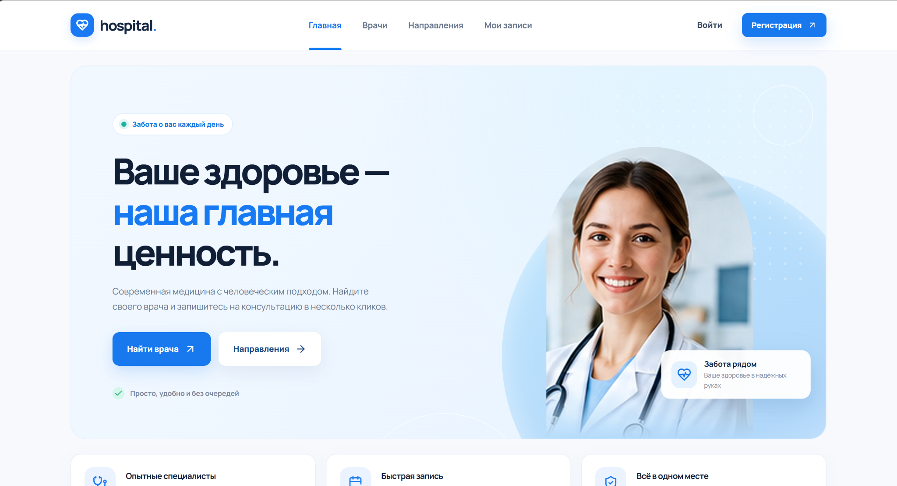

<b>Student developer building practice projects and improving every day.</b>

  
  
  
  

---

## 👨‍💻 About Me

- 🐍 I learn and build projects with **Python**, **Django** and **Django REST Framework**
- 🔗 I create **REST APIs**, work with **authentication**, **databases** and **CRUD**
- ⚛️ I also explore **React** and full-stack development
- 🧠 I improve my skills through real practice projects
- 🚀 My goal is to become a **strong backend developer**

---

## 🛠️ Tech Stack

  

---

## 🌟 Featured Projects

<table>
  <tr>
    <td width="33%" valign="top">
      <h3>🏥 Hospital</h3>
      
Full-stack clinic project with a modern medical interface.

      <ul>
        <li><b>Backend:</b> Django + DRF</li>
        <li><b>Frontend:</b> React + Vite</li>
        <li><b>Features:</b> doctors, directions, appointments, profile pages</li>
      </ul>
      <a href="https://github.com/Danieldev066/Hospital"><b>Open project →</b></a>
    </td>
    <td width="33%" valign="top">
      <h3>🎬 Etnomedia</h3>
      
Movie platform project with a dark cinematic design.

      <ul>
        <li><b>Focus:</b> movie catalog UI</li>
        <li><b>Features:</b> categories, search, filtering, film list</li>
      </ul>
      <a href="https://github.com/Danieldev066/Etnomedia"><b>Open project →</b></a>
    </td>
    <td width="33%" valign="top">
      <h3>🛒 AvitoShop</h3>
      
E-commerce practice project for products and categories.

      <ul>
        <li><b>Features:</b> products, cart, favourites, profile</li>
        <li><b>UI:</b> simple store layout with filters and sorting</li>
      </ul>
      <a href="https://github.com/Danieldev066/Avito"><b>Open project →</b></a>
    </td>
  </tr>
</table>

<!--
Want screenshots? Create an `assets/` folder in this repo, upload hospital.png, etnomedia.png, avito.png,
and add this line inside each project cell (under the title):

-->

---

## 📂 More Repositories

| Repository | Description |
| --- | --- |
| 🏨 [Hotels](https://github.com/Danieldev066/Hotels) | Hotels practice project |
| 📰 [News](https://github.com/Danieldev066/News) | News practice project |
| ✅ [todo_list_project](https://github.com/Danieldev066/todo_list_project) | Learning project |

📁 [See all repositories](https://github.com/Danieldev066?tab=repositories)

---

## 🎯 Currently Learning

- ✅ Clean Django REST API architecture
- ✅ Working with models, serializers and permissions
- ✅ Connecting React frontend with backend API
- ✅ Git, GitHub and project structure

---

## 📊 GitHub Stats

  
  

---

### 🤝 Thanks for visiting my profile!

**Learning • Building • Improving**

