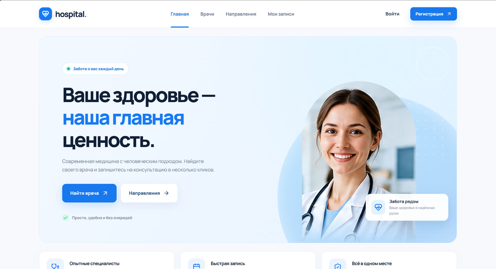
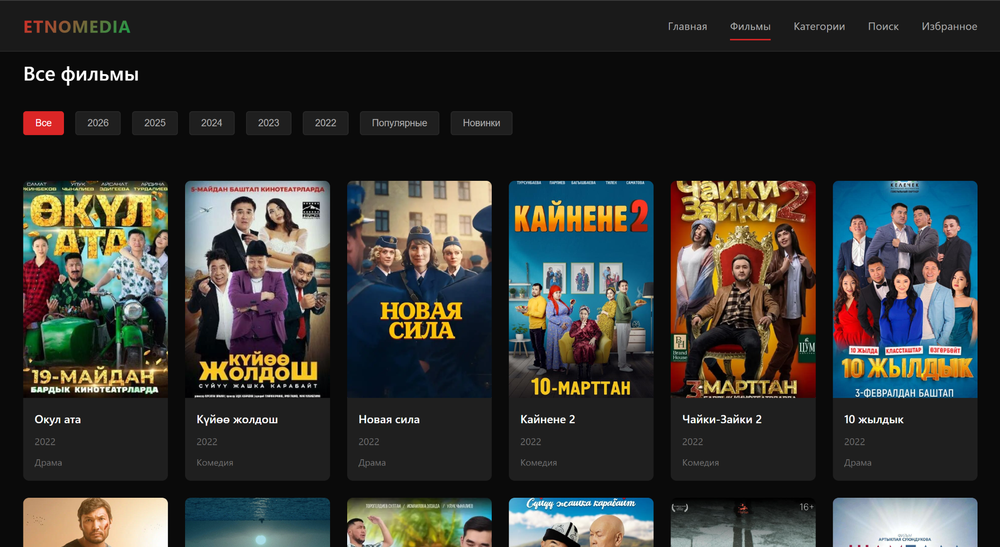

<div align="center">
  
  <h1>Daniel Askerbekov</h1>
  <p><strong>Junior Python Backend Developer</strong> · Bishkek, Kyrgyzstan</p>
  <p>I build Django REST APIs for booking appointments, browsing product catalogs, and publishing articles.</p>
  <p><a href="#featured-work">Explore projects ↓</a> · <a href="#inside-the-api">Trace an API request</a> · <a href="#contact">Get in touch</a></p>
</div>

## Featured work

### Hospital · Clinic booking

<a href="https://github.com/Danieldev066/Hospital"></a>

A clinic demo where patients can find doctors, check schedules, and book or cancel appointments. A React frontend talks to a Django REST API with token authentication and access rules for patients and staff.

[Repository ↗](https://github.com/Danieldev066/Hospital) · [Backend docs ↗](https://github.com/Danieldev066/Hospital/tree/main/Hospital_Backend)

### AvitoShop · Marketplace API

A Django REST API for product discovery. The catalog supports search, price filters, sorting, and pagination. Separate endpoints handle carts, favorites, and reviews.

[Repository ↗](https://github.com/Danieldev066/Avito) · [API routes ↗](https://github.com/Danieldev066/Avito/blob/main/mysite/avito_app/urls.py)

### News · Publishing API

A Django backend for articles, comments, likes, and following authors. Authors can edit their own posts, and access rules keep drafts visible to their authors and admins.

[Repository ↗](https://github.com/Danieldev066/News) · [Permissions ↗](https://github.com/Danieldev066/News/blob/main/blog/permissions.py)

<details>
<summary><strong>See the AvitoShop and Etnomedia interfaces</strong></summary>

<p>
  <a href="https://github.com/Danieldev066/Avito"></a>
  <a href="https://github.com/Danieldev066/Etnomedia"></a>
</p>

[AvitoShop](https://github.com/Danieldev066/Avito) is a marketplace practice project. [Etnomedia](https://github.com/Danieldev066/Etnomedia) is a cinema catalog UI concept.

</details>

Also on GitHub · [Hotels](https://github.com/Danieldev066/Hotels) · [To-do project](https://github.com/Danieldev066/todo_list_project) · [All repositories ↗](https://github.com/Danieldev066?tab=repositories)

## Inside the API

This **Hospital** endpoint lists doctors in one specialization. Follow the request through the backend.

```text
GET /api/doctors/?specialization=1
  │
  ├─ Django routes the request to DoctorViewSet
  ├─ The view filters doctors by specialization ID
  ├─ DoctorSerializer selects fields for the response
  └─ Django REST Framework returns 200 OK with JSON
```

[URL routes ↗](https://github.com/Danieldev066/Hospital/blob/main/Hospital_Backend/clinic/urls.py) · [ViewSet ↗](https://github.com/Danieldev066/Hospital/blob/main/Hospital_Backend/clinic/views.py) · [Serializer ↗](https://github.com/Danieldev066/Hospital/blob/main/Hospital_Backend/clinic/serializers.py)

## Stack

**Backend** · Python, Django, Django REST Framework  
**Data and tools** · SQLite, Django ORM, Git, GitHub, Docker  
**Frontend** · JavaScript, HTML, CSS, React

I’m working on structuring Django REST APIs, testing permissions, and writing more efficient database queries.

## Contact

Open to Python backend collaborations and junior developer roles.

[LinkedIn ↗](https://www.linkedin.com/in/daniel-askerbekov-a69b68449/) · [Telegram ↗](https://t.me/donixx_06) · [Email](mailto:akkdaniel335@gmail.com) · [GitHub ↗](https://github.com/Danieldev066)  
Phone · +996 999 444 625
