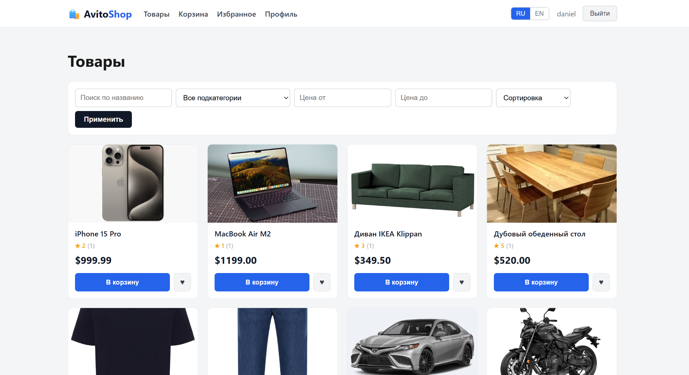

  

  
<strong>Junior backend developer</strong> · Bishkek, Kyrgyzstan

  
Python · Django · Django REST Framework · SQLite

  
<a href="#projects"><b>View projects</b></a> · <a href="#contact">Get in touch</a>

## Projects

<table>
  <tr>
    <td width="33%" valign="top">
       
      <a href="https://github.com/Danieldev066/Hospital"><small><strong>Hospital</strong></small></a> 
      Clinic booking · DRF + React
    </td>
    <td width="33%" valign="top">
       
      <a href="https://github.com/Danieldev066/Avito"><small><strong>AvitoShop</strong></small></a> 
      Marketplace · Search &amp; cart
    </td>
    <td width="33%" valign="top">
       
      <a href="https://github.com/Danieldev066/Etnomedia"><small><strong>Etnomedia</strong></small></a> 
      Cinema catalog · UI concept
    </td>
  </tr>
</table>

**More projects** · [News API](https://github.com/Danieldev066/News) · [Hotels](https://github.com/Danieldev066/Hotels) · [To-do](https://github.com/Danieldev066/todo_list_project) · [All repositories](https://github.com/Danieldev066?tab=repositories)

## Backend focus

I build Django APIs for appointment booking, product catalogs, and publishing. In **Hospital**, patients can book and cancel their own appointments, while staff can manage the clinic schedule.

**Currently exploring** · API testing, permissions, and database queries.  
[Explore Hospital’s API](https://github.com/Danieldev066/Hospital/tree/main/Hospital_Backend) · [Read the News API permissions](https://github.com/Danieldev066/News/blob/main/blog/permissions.py)

## Contact

Open to junior backend roles and Python projects.

[LinkedIn](https://www.linkedin.com/in/daniel-askerbekov-a69b68449/) · [Telegram](https://t.me/donixx_06) · [Email](mailto:akkdaniel335@gmail.com) · +996 999 444 625
