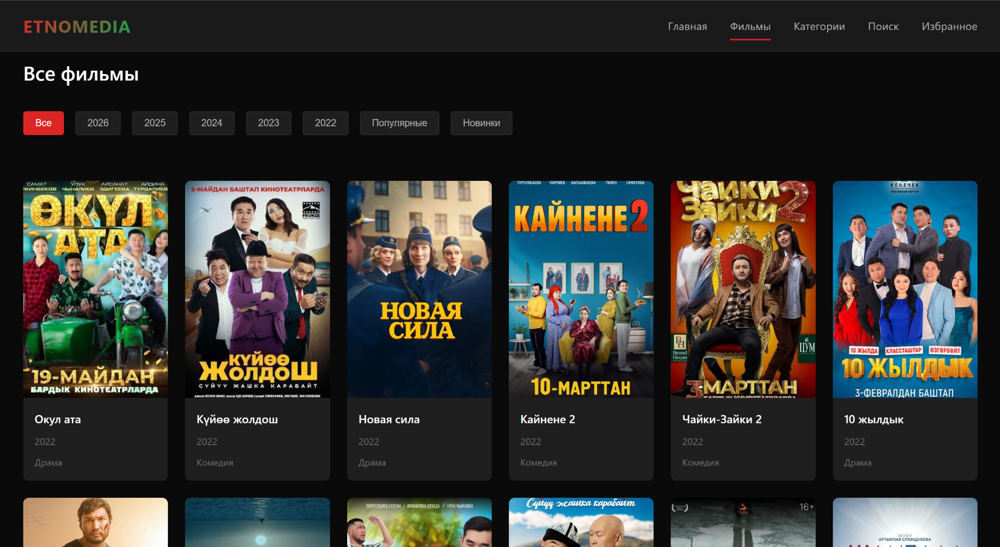
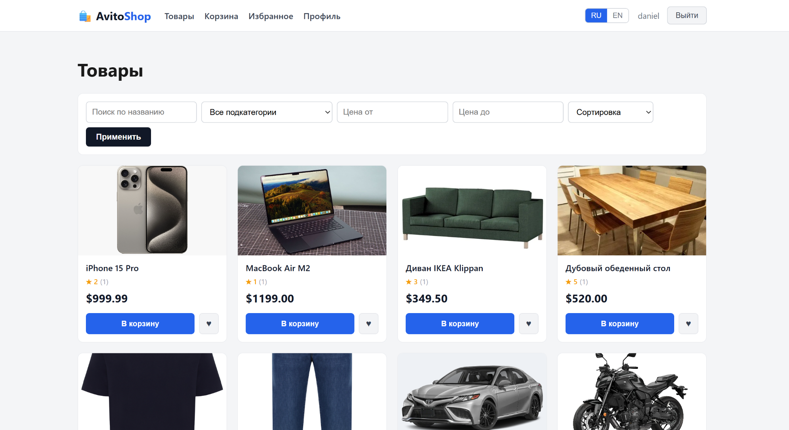

# 👋 Hi, I'm Daniel!

### Python Backend Developer • Django • REST API • React

**Student developer building practice projects and improving every day.**

---

## 👨‍💻 About Me

- 🐍 I learn and build projects with **Python, Django and Django REST Framework**
- 🔗 I create **REST APIs**, work with **authentication, databases and CRUD**
- ⚛️ I also explore **React** and full-stack development
- 🧠 I improve my skills through **real practice projects**
- 🚀 My goal is to become a strong **backend developer**

## 🛠️ Tech Stack

---

## 🌟 Featured Projects

<table>
  <tr>
    <td width="52%" valign="top">
      <h3>🏥 <a href="https://github.com/Danieldev066/Hospital">Hospital</a></h3>
      
<b>Full-stack clinic project</b> with a modern medical interface.

      

        • Backend: <b>Django + DRF</b> 
        • Frontend: <b>React + Vite</b> 
        • Features: doctors, directions, appointments, profile pages
      

      
<a href="https://github.com/Danieldev066/Hospital">Open project →</a>

    </td>
    <td width="48%" valign="top">
      
    </td>
  </tr>

  <tr>
    <td width="52%" valign="top">
      <h3>🎬 <a href="https://github.com/Danieldev066/Etnomedia">Etnomedia</a></h3>
      
<b>Movie platform project</b> with a dark cinematic design.

      

        • Focus: movie catalog UI 
        • Features: categories, search, filtering, film list
      

      
<a href="https://github.com/Danieldev066/Etnomedia">Open project →</a>

    </td>
    <td width="48%" valign="top">
      
    </td>
  </tr>

  <tr>
    <td width="52%" valign="top">
      <h3>🛒 <a href="https://github.com/Danieldev066/Avito">AvitoShop</a></h3>
      
<b>E-commerce practice project</b> for products and categories.

      

        • Features: products, cart, favourites, profile 
        • UI: simple store layout with filters and sorting
      

      
<a href="https://github.com/Danieldev066/Avito">Open project →</a>

    </td>
    <td width="48%" valign="top">
      
    </td>
  </tr>
</table>

---

## 📂 More Repositories

- 👥 [Python48-Team-2](https://github.com/Danieldev066/Python48-Team-2) — team practice repository
- 👥 [Python48-Command-2](https://github.com/Danieldev066/Python48-Command-2) — course team project
- ✅ [todo_list_project](https://github.com/Danieldev066/todo_list_project) — learning project
- 📁 [See all repositories](https://github.com/Danieldev066?tab=repositories)

## 🎯 Currently Learning

- Clean Django REST API architecture
- Working with models, serializers and permissions
- Connecting React frontend with backend API
- Git, GitHub and project structure

---

## 🤝 Thanks for visiting my profile!

**Learning • Building • Improving**

