<!-- GitHub profile README • Place this file in the repository Danieldev066/Danieldev066 -->

<div align="center">



<br />

<a href="https://git.io/typing-svg">
  
</a>

<br />

<a href="https://github.com/Danieldev066"></a>
<a href="https://www.linkedin.com/in/daniel-askerbekov-a69b68449/"></a>
<a href="https://t.me/donixx_06"></a>

</div>

---

### 👾 `whoami`

```yaml
name: Daniel Askerbekov
location: Bishkek, Kyrgyzstan
role: Junior Python Backend Developer
focus: [REST APIs, Authentication, Databases, Backend Architecture]
currently_building: Practical backend applications
mindset: "Learn. Build. Refactor. Repeat."
```

I build backend applications with **Python**, focusing on understandable code, reliable APIs and practical solutions. I'm growing through hands-on projects and collaborative development.

- 🔭 **Current focus:** Django REST Framework, FastAPI and well-structured APIs
- 🧩 **I work with:** models, serializers, CRUD, auth, permissions and databases
- 🌱 **Improving:** testing, architecture, performance and deployment
- 🤝 **Open to:** project collaboration and learning from other developers

### ⚡ Tech universe

<div align="center">


<br />


</div>

---

### 🚀 Featured builds

<table>
<tr>
<td width="50%" valign="top">

<h3>🏥 Hospital</h3>
<p>Clinic management practice project featuring doctors, specialties and appointment-related pages.</p>
<p><code>Django</code> <code>Django REST Framework</code> <code>Backend</code></p>
<a href="https://github.com/Danieldev066/Hospital"><b>Explore repository ↗</b></a>

</td>
<td width="50%" valign="top">

<h3>🎬 Etnomedia</h3>
<p>Cinematic movie-catalog interface with categories, film listings, search and filtering.</p>
<p><code>Movie catalog</code> <code>Search</code> <code>UI</code></p>
<a href="https://github.com/Danieldev066/Etnomedia"><b>Explore repository ↗</b></a>

</td>
</tr>
<tr>
<td width="50%" valign="top">

<h3>🛒 AvitoShop</h3>
<p>E-commerce practice project with product discovery, categories, favorites and shopping-cart features.</p>
<p><code>E-commerce</code> <code>Catalog</code> <code>CRUD</code></p>
<a href="https://github.com/Danieldev066/Avito"><b>Explore repository ↗</b></a>

</td>
<td width="50%" valign="top">

<h3>🧪 More experiments</h3>
<p>Smaller projects where I practice building, organizing and improving applications.</p>
<p>
<a href="https://github.com/Danieldev066/Hotels">Hotels</a> ·
<a href="https://github.com/Danieldev066/News">News</a> ·
<a href="https://github.com/Danieldev066/todo_list_project">Todo List</a>
</p>
<a href="https://github.com/Danieldev066?tab=repositories"><b>Browse all repositories ↗</b></a>

</td>
</tr>
</table>

### 🧭 What I'm building toward

```text
REST API design         █████████░  Keep building
Authentication          ████████░░  Keep practicing
Database modeling       ████████░░  Keep refining
Testing & deployment    ██████░░░░  Keep learning
```

> These bars represent my learning priorities, not measured proficiency levels.

---

### 📈 GitHub pulse

<div align="center">


<br />


</div>

<details>
<summary><b>🧠 My development philosophy</b></summary>
<br />
I like turning an idea into a working API, understanding why something breaks, and making the solution cleaner with each iteration. My goal is to become an engineer who builds systems that are as maintainable as they are useful.
</details>

---

### 📬 Let's connect

<div align="center">

**Have a backend idea, a project or a collaboration opportunity?**

<a href="mailto:akkdaniel335@gmail.com"></a>
<a href="https://t.me/donixx_06"></a>
<a href="https://www.linkedin.com/in/daniel-askerbekov-a69b68449/"></a>

<sub>📍 Biskek, Kyrgyzstan · ✉️ akkdaniel335@gmail.com</sub>

<br /><br />


</div>
